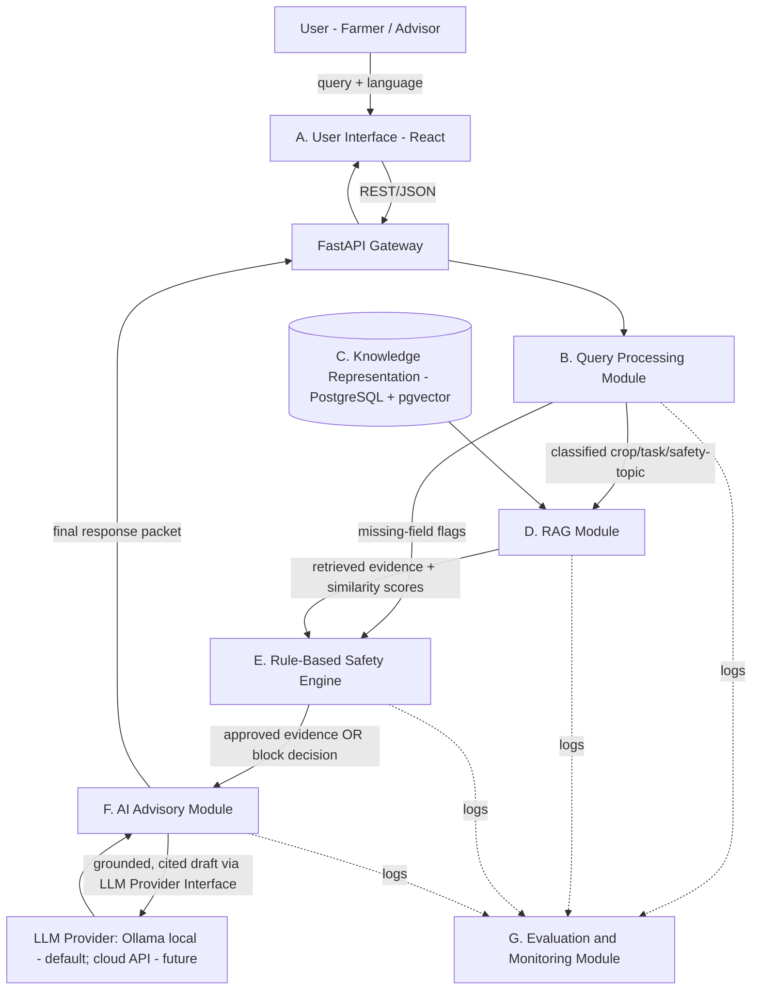
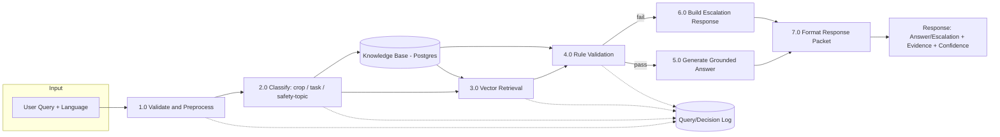

# Safe Pesticide Use Knowledge and Advisory Assistant for Decision Support
## Project Architecture Blueprint (Phase 1 Deliverable)

**Student:** Himanshu Yadav | **Course:** CSE 276
**Project Type:** Group Project | **Source:** Bill & Melinda Gates Foundation-linked agricultural decision support
**Document Status:** Phase 1 architecture **APPROVED**. Phase 2 geographic/language/LLM/crop/team-structure decisions **APPROVED**. Milestone 1 (backend/frontend foundation) and Phase 3 (Knowledge Base, Module C) are **IMPLEMENTED AND TESTED** — see [DECISION_LOG.md](DECISION_LOG.md) (DEC-008, DEC-009), [../docs/MILESTONE_1_REPORT.md](../docs/MILESTONE_1_REPORT.md), and [../docs/PHASE3_KNOWLEDGE_BASE_REPORT.md](../docs/PHASE3_KNOWLEDGE_BASE_REPORT.md). PostgreSQL role/database creation and local Ollama installation remain open environment gaps (not architecture gaps); classifier, RAG, and rule-engine modules (Phases 4-6) have not yet been implemented.

---

## 1. Executive Project Summary

This project builds a decision-support assistant that helps farmers, extension workers, and agri-advisors get **safe, evidence-grounded answers** about pesticide use — which product is approved for which crop, under what conditions, and with what restrictions (dosage limits, pre-harvest interval, re-entry interval, PPE requirements).

The system is explicitly **not** a general chatbot. It is required to demonstrate four integrated technical pillars, each independently gradable:

| Pillar | What it does | Maps to Objective |
|---|---|---|
| Knowledge Representation | Structured DB of approved products, crops, conditions, restrictions, sources | Objective 1 |
| Supervised Classification | Classifies incoming queries by crop / task / safety topic | Objective 2 |
| Retrieval-Augmented Generation (RAG) | Retrieves relevant knowledge chunks and generates a grounded, cited answer | Objective 2 & 3 |
| Rule-Based Reasoning | Validates retrieved evidence, blocks answers when information is missing/contradictory, triggers escalation | Objective 2 |

The output is surfaced through a **multilingual advisory interface** (Objective 3) that always shows: the recommendation (if any), the supporting source evidence, a confidence/verification state, and — when the system cannot safely answer — a clear escalation message instead of a guess.

The core design principle, repeated throughout this blueprint: **the LLM never acts as the source of agricultural fact.** It only explains/paraphrases what the knowledge base + retrieval + rules have already verified. If the rule engine cannot confirm safety-critical information, no recommendation is shown — only an escalation notice.

---

## 2. Detailed Problem Statement

Smallholder and resource-limited farmers frequently apply pesticides based on informal advice, retailer upselling, or outdated practice — not verified label data. This causes:

- **Crop and health risk** from incorrect dosage, timing, or crop–product mismatch.
- **Residue violations** from ignoring pre-harvest intervals (PHI), affecting food safety and export eligibility.
- **Applicator harm** from ignoring re-entry intervals (REI) and PPE requirements.
- **Information fragmentation** — approved-use data exists across scattered government label registries, extension PDFs, and advisory bulletins, in forms that are not queryable in natural language or in regional languages.

Existing systems are either (a) static PDF/label lookups with no conversational interface, or (b) generic LLM chatbots with no grounding, no safety gating, and a real risk of hallucinated dosage/approval claims. Neither is acceptable for a safety-critical agricultural advisory use case.

**Proposed system:** a hybrid architecture where a classifier routes the query, a RAG pipeline retrieves verified knowledge-base evidence with citations, and a deterministic rule engine — not the LLM — decides whether a recommendation may be shown at all. This directly targets the gap between "gives an answer" and "gives a *safe, accountable* answer."

**Scope boundary:** this is a decision-support and advisory tool. It does not replace a licensed agronomist, does not process live field diagnostics (e.g., pest images), and explicitly defers to human experts for any case flagged "unsupported" or "contradictory."

**Target users:** extension workers/agri-advisors as primary users (they relay advice to farmers), progressive farmers with smartphone access as secondary users, and project evaluators/faculty as a tertiary audience (viva, demonstration).

---

## 3. Official Objectives → Implementation Mapping

| Objective (verbatim intent) | System Components Implementing It | Deliverable Evidence |
|---|---|---|
| **1. Knowledge Base Development** — structured KB of approved products, crops, application conditions, safety restrictions, source references | Knowledge Representation Module (C) → PostgreSQL schema (Ch.05) | Populated DB + schema diagram + source citation table |
| **2. Classification and Safety Reasoning** — classify by crop/task/safety topic, retrieve knowledge, apply rules that block on missing/contradictory info | Query Processing Module (B) + RAG Module (D) + Rule-Based Safety Engine (E) | Trained classifiers + retrieval logs + rule test cases (Ch.06, 07, 08) |
| **3. Advisory Interface Development** — multilingual interface with grounded recommendations, evidence, confidence, escalation path | AI Advisory Module (F) + User Interface (A) | Working multilingual UI with evidence panel + escalation flow (Ch.09) |

Every chapter in Section 3 of the master prompt is preserved verbatim in the final report structure (Section 17 below reconfirms this).

---

## 4. Functional Requirements (FR)

| ID | Requirement |
|---|---|
| FR-1 | User can submit a free-text query in a selected language (minimum: English + one regional language). |
| FR-2 | System classifies the query by crop, task type, and safety topic before retrieval. |
| FR-3 | System retrieves top-k relevant knowledge chunks from the vector store, filtered by classified crop/product where applicable. |
| FR-4 | System generates a grounded answer that cites the specific source(s) used. |
| FR-5 | Rule engine validates presence of required fields (approved crop–product pairing, dosage, PHI/REI, PPE) before allowing a recommendation to render. |
| FR-6 | If required information is missing or two sources contradict, the system shows an escalation message instead of a recommendation. |
| FR-7 | UI displays: recommendation (if any), evidence/source snippet, confidence state (Verified / Generated-explanation / Unsupported), and escalation path (e.g., "consult your local agriculture extension office"). |
| FR-8 | Admin/curator can add or update knowledge-base entries with source metadata (date, authority, geography). |
| FR-9 | System logs every query, classification output, retrieved evidence, rule decision, and final response for evaluation/audit. |
| FR-10 | Language selector persists across a session. |

## 4.1 Non-Functional Requirements (NFR)

| ID | Requirement |
|---|---|
| NFR-1 | **Safety over completeness**: prefer "no answer" to an unverified answer. |
| NFR-2 | Response latency target: < 5 seconds per query on local/demo deployment. |
| NFR-3 | All secrets/API keys stored in environment variables, never committed to source control. |
| NFR-4 | System must run fully on a local/demo machine without mandatory paid cloud dependency (paid LLM API is optional/swappable). |
| NFR-5 | Modular codebase — each of the 7 logical components (A–G) is independently testable. |
| NFR-6 | Every pesticide-related claim traceable to a source with a recorded date. |
| NFR-7 | Classification and retrieval metrics must be measured on real (even if small) held-out data — never fabricated. |
| NFR-8 | UI must remain usable on a low-bandwidth/basic smartphone browser (lightweight frontend, minimal payload). |

## 4.2 User Requirements
- Advisors need fast, source-backed answers they can relay with confidence.
- Farmers need simple, jargon-light phrasing in their own language.
- Faculty/evaluators need transparent traceability from question → classification → evidence → rule decision → answer.

## 4.3 System Constraints
- No budget guarantee for a paid LLM API — architecture must support a free/local model fallback.
- Limited time (academic semester) — knowledge base will start with a **curated seed set** (tens, not thousands, of product–crop records), explicitly labeled as a pilot dataset.
- No access to proprietary/paid agrochemical databases — must rely on publicly published government/extension sources.

## 4.4 Project Assumptions (APPROVED — see Decision Log)
- **Geographic scope:** India. Only CIB&RC-registered pesticide products are in scope; every product approval and permitted use must be verified against authoritative Indian sources (CIB&RC label database, state agriculture department bulletins, ICAR/KVK advisories) before entering the knowledge base.
- **Multilingual pilot:** English + Hindi. The language layer (UI strings, translation step, language tag in schema/logs) is designed to be extensible — adding a third Indian language later must not require redesigning the classifier, RAG, or rule engine, only adding language-tagged data/strings.
- **LLM provider:** Ollama with a locally hosted open model is the default/initial provider, chosen to avoid per-call API cost. The AI Advisory Module (F) must access the LLM through a provider-agnostic interface so a cloud LLM API can be added later as a drop-in alternative without redesigning Modules B–F.
- **Pilot crops:** Rice, Wheat, Maize, Cotton, Tomato.
- **Pilot knowledge base target:** approximately 10–20 verified pesticide product records for the five pilot crops. This is a target, not a quota — the team will not fabricate products, approvals, dosage, or permitted-use data to reach the number; a smaller set of fully verified records is preferred over a larger set with gaps.
- The evaluation dataset for classification/retrieval will be hand-curated by the team, not scraped from an unverified source.

---

## 5. Recommended Technology Stack

> These are recommendations with justification, not mandates — flagged for your approval in Section 18.

| Layer | Recommended Technology | Why | Used By Module | Free/Paid |
|---|---|---|---|---|
| Frontend | **React (Vite) + i18next** | Component-based, large ecosystem, i18next is the standard i18n library for language switching without reload | A (UI) | Free |
| Backend API | **Python + FastAPI** | Async-native, auto-generates OpenAPI docs (useful for viva demo), same language as ML/RAG stack avoids a serialization boundary | B, D, E, F | Free |
| Primary Database | **PostgreSQL** | Relational integrity for structured KB (products/crops/restrictions/sources), mature, free, widely taught | C | Free |
| Vector Search | **pgvector (Postgres extension)** | Keeps one database instead of two; sufficient for a pilot-scale KB (hundreds–low thousands of chunks); avoids running a separate vector DB server | D | Free |
| ML Classification | **scikit-learn** (TF-IDF / multilingual embeddings + Logistic Regression or Linear SVM) | Interpretable, fast to train on a small labeled set, easy to explain in viva (coefficients, confusion matrix) vs. a black-box deep model | B | Free |
| Embeddings (RAG) | **sentence-transformers**, multilingual model (e.g., `paraphrase-multilingual-MiniLM-L12-v2`) | Open-source, runs locally (no per-call API cost), supports cross-lingual retrieval needed for Objective 3 | D | Free |
| LLM (answer phrasing only) | **Ollama (local model, default)**, accessed through a provider-agnostic interface so a cloud LLM API can be swapped in later | Used strictly to phrase the final answer from retrieved+rule-approved content — never to originate facts. Ollama chosen as default to avoid per-call API cost (APPROVED decision) | F | Ollama local = free but needs local compute; cloud API = paid/metered, added later via the same interface without redesign |
| Rule Engine | **Custom Python rule classes** (no heavy external rules-engine library) | Full transparency for safety logic is more valuable here than a generic rules DSL; easier to unit-test and explain in viva | E | Free |
| Testing | **pytest** (+ scikit-learn metrics, a small retrieval eval set) | Standard, integrates with CI | All | Free |
| Deployment (demo) | **Docker Compose** locally; optional free-tier host (e.g., Render/Railway) only if live demo is required | Keeps infra simple for an academic deadline; avoids managing Kubernetes etc. | All | Free tier likely sufficient |

**Explicitly avoided:** a second standalone vector-database server (e.g., separate Milvus/Pinecone cluster) — unnecessary operational overhead for a pilot-scale KB; a heavyweight workflow/orchestration framework — unnecessary for a single-pipeline RAG flow; a deep-learning classifier — unjustified given small labeled data and the need for explainability.

**Per-technology limitation notes:**
- pgvector: performance degrades at very large (>1M vector) scale — acceptable here, would need a dedicated vector DB only if the KB grows far beyond a pilot.
- sentence-transformers multilingual models: quality on **low-resource regional languages** (beyond Hindi) is uncertain and must be evaluated, not assumed (see Chapter 10 multilingual testing).
- Hosted LLM API: introduces a paid/rate-limited dependency; mitigated by keeping LLM usage out of the fact-decision path and supporting a local-model fallback.
- scikit-learn classifiers: accuracy is bounded by the size/quality of the hand-labeled query dataset — must be reported honestly, not inflated.

---

## 6. Overall System Architecture



**Why this shape:** the Rule-Based Safety Engine sits **between** retrieval and advisory generation — it has veto power over whether anything reaches the LLM/UI at all. This is the architectural guarantee that satisfies Objective 2's "block responses when required information is missing or contradictory."

---

## 7. Detailed Component Architecture

### A. User Interface
- React SPA; language selector drives i18next locale + is passed to backend as a query parameter.
- Renders four always-visible zones: **Answer**, **Evidence/Sources**, **Confidence badge** (`Verified` / `Generated-explanation` / `Unsupported — escalated`), **Escalation box** (shown only when triggered).

### B. Query Processing Module
- Input validation (length, empty, injection-pattern checks).
- Preprocessing: normalization, language detection fallback if selector is skipped.
- Three scikit-learn classifiers (crop, task-type, safety-topic) run in sequence/parallel; a confidence threshold per classifier flags low-confidence classification as "needs clarification."
- Missing-information detector: checks if the classified crop/product pair even exists in the KB index before attempting retrieval (early rule check).

### C. Knowledge Representation Module
- PostgreSQL schema (Section 9) holding products, crops, approved-use links, restrictions, and sources with mandatory date/authority fields.
- This is the **single source of truth** — RAG only retrieves from text derived from this structured data (plus ingested source documents), never from open web content at answer time.

### D. RAG Module
- Ingestion: curated PDFs/CSVs of label data and extension bulletins → chunked (~300–500 tokens, with overlap) → embedded (multilingual sentence-transformers) → stored in pgvector with metadata (crop, product, source_id, language).
- Retrieval: top-k cosine similarity search, filtered by classifier output (crop/product) when available, to reduce irrelevant matches.
- Evaluation: Precision@k / Recall@k against a hand-built query↔relevant-chunk mapping.

### E. Rule-Based Safety Engine
- Deterministic Python rule classes, e.g.:
  - `RequireApprovedPair`: blocks if crop–product combination isn't in the KB.
  - `RequireSafetyFields`: blocks if PHI, REI, or dosage fields are null for the matched record.
  - `ContradictionCheck`: flags if two retrieved sources disagree on a safety-critical field.
  - `ConfidenceGate`: blocks if classifier or retrieval similarity confidence is below threshold.
- Output is one of: `APPROVED_WITH_EVIDENCE`, `ESCALATE_MISSING_INFO`, `ESCALATE_CONTRADICTION`, `ESCALATE_LOW_CONFIDENCE`.

### F. AI Advisory Module
- Only when the rule engine returns `APPROVED_WITH_EVIDENCE` does it construct an LLM prompt strictly containing the retrieved, approved evidence, instructing the model to paraphrase/translate — not add facts.
- **LLM Provider Interface (APPROVED, Phase 2):** a thin abstraction (e.g., `LLMProvider.generate(prompt, language) -> text`) with one concrete implementation, `OllamaProvider`, for the pilot. A future `CloudAPIProvider` implementing the same interface can be added without touching Modules B–E or the prompt-construction logic in F.
- For any `ESCALATE_*` state, it renders a fixed, non-LLM-generated escalation template (removes hallucination risk exactly where it matters most).

### G. Evaluation and Monitoring Module
- Structured logs per query: classification output, retrieved chunk IDs + scores, rule decision, final response type, latency.
- Periodic batch evaluation scripts produce the metrics used in Chapter 10 (never hand-typed/estimated numbers).

---

## 8. End-to-End Data Flow (Level 1 DFD)



**DFD Level 0 (context diagram):** a single process "Pesticide Advisory System" with external entities **User** (sends query, receives advisory) and **Curator/Admin** (maintains Knowledge Base), and one data store, the **Knowledge Base**.

---

## 9. Database and Knowledge-Base Schema

```sql
-- Core entities
products(product_id PK, trade_name, active_ingredient, formulation_type,
         registration_number, approving_authority, approval_date)

crops(crop_id PK, crop_name, crop_category)

sources(source_id PK, title, authority, url_or_document_ref,
        publication_date, retrieved_date, geography, reliability_tier)

-- Knowledge relationships
approved_use(approved_use_id PK, product_id FK, crop_id FK,
             target_pest, dosage_min, dosage_max, dosage_unit,
             application_method, max_applications_per_season,
             source_id FK)

safety_restriction(restriction_id PK, approved_use_id FK,
                    restriction_type ENUM('PHI','REI','PPE','TOXICITY_CLASS','MAX_RESIDUE'),
                    restriction_value, unit, notes, source_id FK)

-- Classification / evaluation support
query_log(query_id PK, raw_text, language, timestamp,
          classified_crop_id FK NULL, classified_task_type,
          classified_safety_topic, classifier_confidence)

rule_decision_log(decision_id PK, query_id FK, decision_type,
                   triggered_rule, evidence_chunk_ids, timestamp)

kb_chunks(chunk_id PK, source_id FK, crop_id FK NULL, product_id FK NULL,
          language, chunk_text, embedding VECTOR(384))
```

**Design notes:**
- `sources.reliability_tier` lets the rule engine weight contradictions (e.g., national regulator > regional bulletin).
- `kb_chunks` is the pgvector-indexed table; `embedding` dimension (384 shown) matches the chosen sentence-transformers model and will be finalized in Phase 3.
- Every fact-bearing table carries a `source_id` — this directly implements Data Requirement #2 in Section 5 of the master prompt (source traceability for every pesticide-related recommendation).

---

## 10. Supervised Classification Methodology

- **Problem definition:** three independent (or chained) multi-class classification tasks run on the same query text — (1) **crop** (e.g., rice, cotton, wheat, "unspecified"), (2) **task type** (e.g., dosage inquiry, approval check, safety/PHI inquiry, general info), (3) **safety topic** (e.g., PHI, REI, PPE, toxicity, none).
- **Dataset preparation:** team hand-writes/collects a labeled query set per class (target: ≥30–50 examples per class for the pilot), explicitly logged as a **pilot dataset**, not claimed as production-scale.
- **Labeling methodology:** two team members independently label each query; disagreements resolved by discussion; inter-annotator agreement recorded for the report (honest metric, not assumed 100%).
- **Feature engineering:** TF-IDF n-grams (1–2) as the baseline; optionally multilingual sentence embeddings as a second feature set for comparison.
- **Model selection:** Logistic Regression / Linear SVM baselines chosen for interpretability and viva-explainability; a confusion matrix and per-class precision/recall will be reported — not a single inflated accuracy number.
- **Train/test split:** stratified split (e.g., 80/20) given the small dataset size; cross-validation used to reduce variance in reported metrics.
- **Model limitations (to be stated upfront in the report):** small training set → limited generalization; performance on regional-language queries will likely be the weakest point and must be reported as such, not hidden.

## 11. RAG Methodology

- **Document ingestion:** curated government/extension PDFs and bulletins (identified in Phase 3) converted to text, each tagged with its `source_id`.
- **Chunking strategy:** fixed-size token windows (~300–500 tokens) with ~15% overlap, chunk boundaries aligned to the structured record where possible (one chunk ≈ one approved-use entry + its restriction text) so retrieval naturally returns a complete, citable fact unit.
- **Embedding generation:** multilingual sentence-transformer model, computed once at ingestion and stored in `kb_chunks.embedding` (pgvector).
- **Similarity search:** cosine similarity top-k (k configurable, start k=5), optionally pre-filtered by the classifier's predicted crop/product to improve precision.
- **Retrieval evaluation:** a hand-built set of (query → expected relevant chunk_id) pairs is used to compute Precision@k and Recall@k — reported honestly even if the pilot KB is small.
- **Context-grounded answer generation:** the LLM prompt template explicitly instructs: "Only use the facts in the provided context. Do not add information not present. Cite source titles." This is a mitigation, not a guarantee — hence the rule engine remains the actual safety gate, not the prompt instruction alone.
- **Source citations:** every generated answer carries the `source_id`/title + publication date of each chunk actually used.

## 12. Rule-Based Safety Engine Design

| Rule | Trigger Condition | Action |
|---|---|---|
| `RequireApprovedPair` | No `approved_use` row exists for classified crop+product | `ESCALATE_MISSING_INFO` |
| `RequireSafetyFields` | PHI, REI, or dosage is NULL on the matched record | `ESCALATE_MISSING_INFO` |
| `ContradictionCheck` | Two retrieved chunks from different sources disagree on a safety-critical numeric field beyond a tolerance | `ESCALATE_CONTRADICTION` |
| `ConfidenceGate` | Classifier confidence < threshold OR top retrieval similarity < threshold | `ESCALATE_LOW_CONFIDENCE` |
| `StaleSourceCheck` | Matched source's `publication_date` older than a configurable freshness window | Attach "verify currency" warning, does not block alone |

- **Escalation mechanism:** a fixed, template-based message (not LLM-generated) directing the user to a human/extension contact — satisfies the "human oversight mechanism" requirement (Section 5, item 10 of the master prompt).
- **Validation test cases:** the team will write explicit unit tests per rule (e.g., "missing PHI field → must escalate," "two contradicting dosage sources → must escalate, never average or guess"). Results reported in Chapter 08/10, with pass/fail counts — never simulated as "100% safe" without actual test execution.

## 13. Multilingual Interface Design (APPROVED scope: English + Hindi)

- Language selector (pilot scope: **English + Hindi**, confirmed) drives both UI string localization (i18next) and a language tag passed to the backend.
- Backend either retrieves same-language KB chunks directly (if ingested in that language) or translates the final, rule-approved evidence snippet into the target language as a presentation step — translation happens **after** the safety decision, never before, so translation errors cannot alter which facts are considered valid.
- Confidence badge and escalation text are pre-translated fixed strings (not live-generated), ensuring escalation messaging is never garbled or altered by translation drift.
- **Extensibility for additional Indian languages (APPROVED requirement):** every language-dependent piece of state — UI string bundles (i18next namespaces), `kb_chunks.language`, `query_log.language`, and the fixed escalation-template dictionary — is keyed by a language code, not hardcoded to two languages. Adding a third language (e.g., Marathi, Tamil) means adding a new language code + string bundle + optionally new-language KB chunks; it does not require changing the classifier, RAG retrieval logic, or rule engine.
- Multilingual testing (Chapter 10) will specifically test whether Hindi retrieval/classification quality holds up relative to English — and report degradation honestly if it does not.

## 14. Security and Safety Considerations

- **Secrets management:** `.env` file (git-ignored) for DB credentials and any LLM API key; never hardcoded.
- **Input validation:** reject queries with injection patterns before they reach the DB/LLM layer; parameterized SQL only (no string-built queries).
- **Least privilege:** the backend DB role used by the API has read/write only on the application schema, not superuser.
- **Audit logging:** every query, classification, retrieval, and rule decision is logged (Module G) — supports both evaluation and safety-incident review.
- **Content safety:** the LLM is never allowed to originate pesticide facts — it only paraphrases/translates rule-approved evidence; this is the primary safety architecture decision of the whole project, repeated in Sections 1, 7, 11, 13.
- **Data privacy:** no personal farmer data is required for the system to function; if any is collected (e.g., location for geography-specific rules), it should be minimized and not stored longer than needed for the session/log retention policy the team defines.

## 15. Testing and Evaluation Strategy

| Test Type | Scope | Method |
|---|---|---|
| Unit testing | Individual rule classes, classifier wrapper functions, retrieval function | pytest |
| Integration testing | Query → classify → retrieve → rule-check → response pipeline | pytest with fixture KB |
| System testing | Full UI → API → DB round trip | Manual + scripted scenarios |
| Classification evaluation | Crop/task/safety classifiers | Accuracy, precision/recall, confusion matrix on held-out labeled set |
| Retrieval evaluation | RAG pipeline | Precision@k, Recall@k on hand-built relevance set |
| Safety testing | Rule engine | Explicit test cases for missing-info, contradiction, low-confidence scenarios — pass/fail counted |
| Multilingual testing | Classification + retrieval + UI in second language | Same metrics computed per language, compared |
| Performance evaluation | Latency per module and end-to-end | Timed logs from Module G under a fixed query set |

All numbers reported in Chapter 10/11 must come from actually executed tests on the real (pilot) dataset — never estimated, assumed, or fabricated, per the master prompt's explicit prohibition.

## 16. Complete Development Roadmap

| Phase | Deliverable | Depends On |
|---|---|---|
| 1 | Requirements + Architecture (this document) | — |
| 2 | Tech stack finalized, repo scaffolded, env config, Docker Compose skeleton | Phase 1 approval |
| 3 | Knowledge base: source research, schema creation, seed data entry (curated pilot set) | Phase 2 |
| 4 | Classification: labeled query dataset, trained scikit-learn models, evaluation report | Phase 3 (needs crop/product vocabulary) |
| 5 | RAG pipeline: ingestion, chunking, embeddings, pgvector retrieval, retrieval evaluation | Phase 3 |
| 6 | Rule-based safety engine + its unit tests | Phases 4 & 5 (needs classifier output + retrieval output) |
| 7 | AI advisory integration (LLM prompt template, response assembly) | Phase 6 |
| 8 | Multilingual UI (React + i18next) wired to backend | Phase 7 |
| 9 | Full testing & evaluation (Chapter 10 metrics) | Phase 8 |
| 10 | Deployment (Docker Compose demo, optional free-tier host) | Phase 9 |
| 11 | Final documentation (all 12 chapters) + presentation deck + viva prep | All prior phases |

Each phase will be completed, reviewed, and explicitly approved before the next begins, per the master prompt's methodology rule.

## 17. Final Presentation Chapter Structure (Confirmed, Unchanged)

Chapters 01–12 exactly as specified in the master prompt (Project Introduction → Objectives & Requirements → Technology Stack → System Architecture → Knowledge Representation → Supervised Classification → RAG → Rule-Based Reasoning → Multilingual Advisory Interface → Testing and Evaluation → Final Project Outcome → Future Scope and Conclusion). This blueprint's sections map onto those chapters as follows: §1–2 → Ch.01–02; §5 → Ch.03; §6–9 → Ch.04–05; §10 → Ch.06; §11 → Ch.07; §12 → Ch.08; §13 → Ch.09; §15 → Ch.10. Chapters 11–12 will be written after implementation, populated with real screenshots and real results only.

## 18. Technical Risks and Mitigation

| Risk | Impact | Mitigation |
|---|---|---|
| Small/weak labeled dataset limits classifier accuracy | Lower-than-ideal classification metrics | Report honestly; emphasize interpretability + rule engine as the actual safety backstop, not the classifier alone |
| Multilingual embedding/LLM quality is weak for the chosen regional language | Degraded non-English experience | Scope pilot language choice carefully (Section 19 open question); test early (Phase 5–6), not at the end |
| Source scarcity for a given crop/product/geography | KB gaps → frequent escalation | Treat frequent, correct escalation as a *success* of the safety design, not a failure — document this framing clearly for viva |
| LLM provider cost/rate limits | Demo interruption | Default to a local model (Ollama) fallback; keep LLM usage read-only/paraphrasing so a fallback model degrades gracefully |
| Contradiction logic too strict/too loose | False escalations or missed contradictions | Tune tolerance thresholds using the safety test case suite (Chapter 08) before finalizing |
| Scope creep (team attempts full national-scale KB) | Missed deadline | Explicitly cap pilot KB to a small, clearly labeled "pilot dataset" (Section 4.3) |

---

## 19. Conclusion of Blueprint — Decisions (RESOLVED) and Remaining Items

### Architecture decisions — APPROVED
1. Technology stack in Section 5 — approved as-is, with LLM provider pinned to Ollama (default) behind a provider-agnostic interface (see §5, §7F).
2. Rule-engine-as-gatekeeper design (§7E/§12) — approved; the LLM is never allowed to originate facts, only paraphrase approved evidence.
3. Database schema in Section 9 — approved as the Phase 3 starting point.

### Previously open questions — now RESOLVED (full detail in [DECISION_LOG.md](DECISION_LOG.md))
1. **Geographic scope:** India, CIB&RC-registered products, verified against authoritative Indian sources. ✅ RESOLVED
2. **Multilingual pilot language:** English + Hindi, architecture extensible to additional Indian languages. ✅ RESOLVED
3. **LLM provider:** Ollama (local) as default/initial, provider-agnostic interface for future cloud API addition. ✅ RESOLVED
4. **Pilot crops:** Rice, Wheat, Maize, Cotton, Tomato; target ~10–20 verified product records (count is secondary to verification). ✅ RESOLVED
5. **Team role split:** Yes — see module-wise responsibility matrix in [../02_Phase2_Setup/PHASE2_IMPLEMENTATION_PLAN.md](../02_Phase2_Setup/PHASE2_IMPLEMENTATION_PLAN.md) §8 (placeholders until the group member list is provided). ✅ RESOLVED (structure); member names PENDING

### Data requirements (to begin Phase 3) — still pending execution
- A shortlist of authoritative sources for India (CIB&RC label database, state agriculture department bulletins, ICAR/KVK advisories) — must be identified and authority-checked, not assumed, before ingestion. **PENDING.**
- At least one labeled query example set per classification category (Section 10) — team-authored. **PENDING.**
- Verified source documents/pages for the 5 pilot crops, each with a recorded date and authority. **PENDING.**

### Estimated implementation complexity
(unchanged from original estimate — see table below)
- **Knowledge Base (Phase 3):** Medium — mostly data-curation effort, limited by source availability for India/the 5 pilot crops.
- **Classification (Phase 4):** Low–Medium — standard scikit-learn pipeline, main effort is dataset labeling (English + Hindi).
- **RAG (Phase 5):** Medium — pgvector + sentence-transformers integration is standard, but chunking/retrieval tuning needs iteration, and Hindi retrieval quality needs explicit validation.
- **Rule Engine (Phase 6):** Medium — logic itself is simple, but defining complete/correct safety rules requires domain care.
- **Advisory + Multilingual UI (Phase 7–8):** Medium — integration-heavy; Ollama local-inference latency on team hardware is an added unknown to validate early.
- **Testing/Deployment/Docs (Phase 9–11):** Medium–High — documentation and honest evaluation are grading priorities; needs real time allocation.

### Recommended first implementation task
See the Phase 2 Implementation Plan ([../02_Phase2_Setup/PHASE2_IMPLEMENTATION_PLAN.md](../02_Phase2_Setup/PHASE2_IMPLEMENTATION_PLAN.md)) for the concrete first-task sequencing, now presented for your review.

---

**STATUS: Phase 1 blueprint APPROVED. All Section 19 open questions RESOLVED (see Decision Log). Phase 2 setup plan drafted and presented for review — no scaffolding/code has been created yet. Awaiting your approval of the Phase 2 plan before any files are created.**
